<!-- ╭──────────────────────────────────────────────────────────────╮ -->
<!-- │  murk · github profile  ·  iOS tools, plugins & research       │ -->
<!-- ╰──────────────────────────────────────────────────────────────╯ -->

<div align="center">



<br/>

<a href="https://murk-sus.github.io/"></a>
<a href="https://t.me/jailbreak_IOS_and_tweaks"></a>
<a href="https://murk-sus.github.io/donate/"></a>


</div>


## `~` whoami

```ansi
murk@unit-02 ~ % cat about.txt
```

> I take an idea that starts with **“what if…?”** and turn it into something people can
> actually install, learn from, or break on purpose. I live between **iOS tooling**,
> **plugin ecosystems**, and **low-level research** — and I like shipping the tool I wished existed.

<table>
<tr>
<td width="33%" align="center"><b>📱 PLATFORM</b><br/><sub>iOS · signing · sideloading · customization</sub></td>
<td width="33%" align="center"><b>🧩 BUILDER</b><br/><sub>plugins · SDKs · desktop tools</sub></td>
<td width="33%" align="center"><b>🧬 RESEARCH</b><br/><sub>kernel · sandbox · GPU · honest notes</sub></td>
</tr>
</table>


## 🚀 Featured — ready for launch

<table>
<tr>
<td width="50%" valign="top">

### 🔍 [IPALens](https://murk-sus.github.io/IPALens/)
 

Drop an **IPA, .deb tweak, .mobileprovision or .p12** into your browser and instantly see:
decrypted or not · injected tweaks · **is my UDID in this profile** · p12 ↔ profile match ·
rootless / roothide · ad & tracking SDKs · **TrollStore / jailbreak** entitlements · diff two IPAs.

Nothing is uploaded. `EN · RU · 中文`

<a href="https://murk-sus.github.io/IPALens/"></a>

</td>
<td width="50%" valign="top">

### 🎀 [SayoSign](https://github.com/murk-sus/SayoSign)
 

An **on-device IPA signer** with its own from-scratch engine in C — no OpenSSL, no zsign inside.
Sign with a **.p12 or Apple ID**, inject tweaks with the built-in SayoHook engine,
check revocation live via **OCSP**, install offline. **Apple ID sign-in works again in 1.1** (anisette v3).

`EN · RU · 中文`

<a href="https://github.com/murk-sus/SayoSign/releases/latest"></a>

</td>
</tr>
<tr>
<td width="50%" valign="top">

### 🖥 [SayoSign Desktop](https://github.com/murk-sus/SayoSign-Desktop)
 

A Sideloadly-style app: sign & install over USB with a **.p12 or Apple ID**, inject tweaks, and run an **anisette server on your PC** for your iPhone — scan the QR code and Apple ID sign-in just works.

<a href="https://github.com/murk-sus/SayoSign-Desktop/releases/latest"></a>

</td>
<td width="50%" valign="top">

### 📖 [yuri4iPhone](https://github.com/murk-sus/yuri4iPhone)
 

An open iPhone toolbox for the desktop: device dashboard, storage breakdown, apps, files, live logs, and a **Customize** panel that unlocks only the tools that work on your phone — stock, TrollStore or jailbroken.

<a href="https://github.com/murk-sus/yuri4iPhone/releases/latest"></a>

</td>
</tr>
</table>


## 🍓 Project hangar

<table>
<tr><th align="left">🧬 RESEARCH</th><th align="left">MISSION</th></tr>
<tr><td><a href="https://github.com/murk-sus/kamui-escape"><b>KAMUI</b></a> </td><td>iOS 27.x sandbox escape + MobileGestalt editor. MIT, free for everyone.</td></tr>
<tr><td><a href="https://github.com/murk-sus/natsuk1"><b>natsuk1</b></a></td><td>iOS 27.2 F1/AGX kernel research archive: IOSurface wrap, AGX sel8, SPTM/TTBAT.</td></tr>
<tr><td><a href="https://github.com/murk-sus/F1OOB-PoC"><b>F1OOB-PoC</b></a></td><td>IOSurface → AGX/Metal cross-object GPU OOB write proof of concept.</td></tr>
<tr><td><a href="https://github.com/murk-sus/asuka4scape"><b>asuka4scape</b></a></td><td>Jailbreak-adjacent tooling and experiments.</td></tr>
</table>

<table>
<tr><th align="left">🧩 PLUGINS & SDK</th><th align="left">INSIDE THE LAB</th></tr>
<tr><td><a href="https://github.com/murk-sus/VoidGram-Plugin-SDK"><b>VoidGram Plugin SDK</b></a></td><td>Full API reference, docs, examples and tools for building VoidGram plugins.</td></tr>
<tr><td><a href="https://github.com/murk-sus/VoidGram-plugins"><b>VoidGram Plugins</b></a></td><td>Catalog of plugins for VoidGram, the iOS Telegram client I develop.</td></tr>
<tr><td><a href="https://github.com/dsn2fvhmn4-lgtm/AyuGramm-IOS"><b>VoidGram for iOS</b></a></td><td>Telegram client for iOS — I'm one of its developers: features, plugin system, SDK.</td></tr>
</table>

<table>
<tr><th align="left">🎨 DESKTOP & FUN</th><th align="left">SIDE QUESTS</th></tr>
<tr><td><a href="https://github.com/murk-sus/femboy-rice"><b>femboy-rice</b></a></td><td>KDE Plasma theme switcher — 19 themes from GRUB and Plymouth to SDDM and the terminal.</td></tr>
<tr><td><a href="https://github.com/murk-sus/AI-helper-windows-11"><b>AI Helper Terminal</b></a></td><td>Small Windows automation utility.</td></tr>
</table>


## 🎀 Tool palette

<p>
  
  
  
  
  
  
</p>


## 📊 Pilot telemetry

<div align="center">


</div>


## 🐍 Contribution garden

<div align="center">

<picture>
  <source media="(prefers-color-scheme: dark)" srcset="https://raw.githubusercontent.com/murk-sus/murk-sus/output/github-contribution-grid-snake-dark.svg"/>
  <source media="(prefers-color-scheme: light)" srcset="https://raw.githubusercontent.com/murk-sus/murk-sus/output/github-contribution-grid-snake.svg"/>
  
</picture>

<br/><br/>

<a href="https://murk-sus.github.io/donate/"></a>

<sub>USDT · TON · BTC · ETH · SOL — <a href="https://murk-sus.github.io/donate/">murk-sus.github.io/donate</a></sub>

</div>
